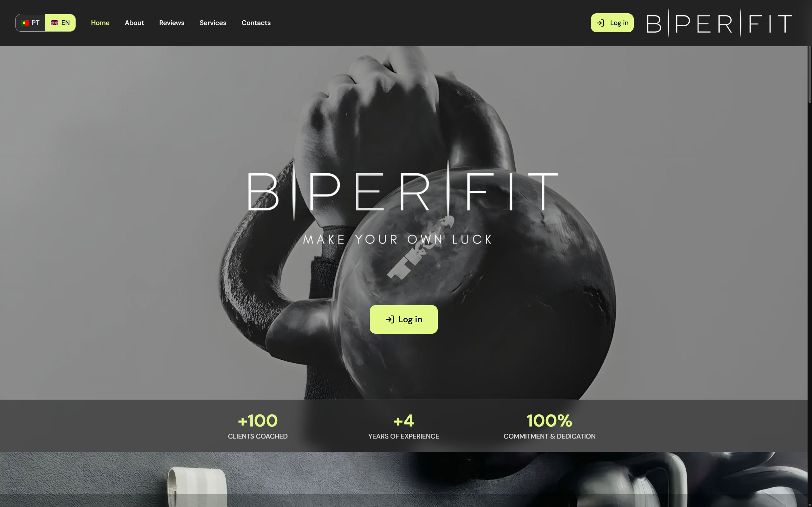
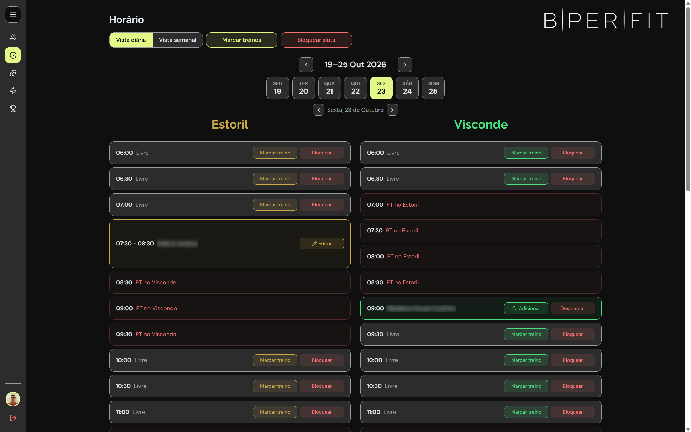
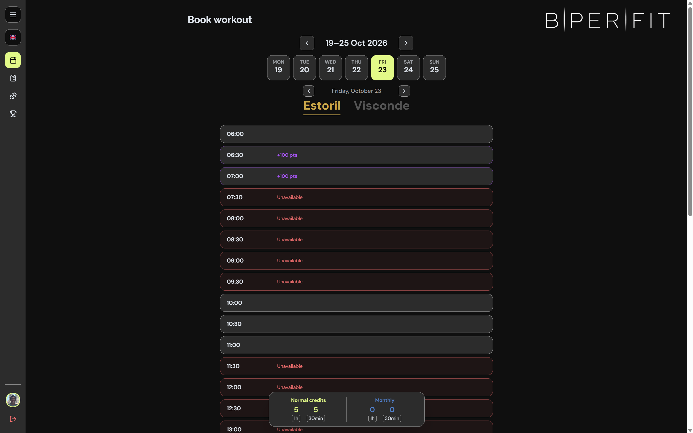
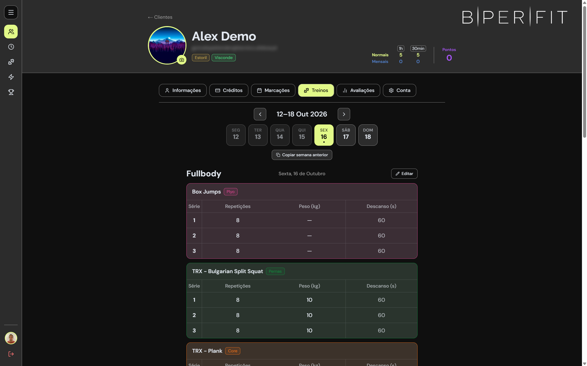
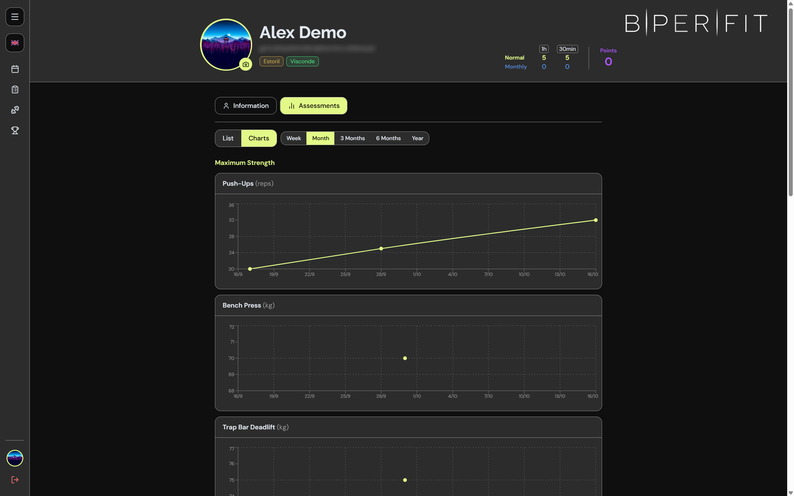

# BPERFIT Platform

The booking and training platform I built for **BPERFIT**, a personal training
studio in Portugal. Live at **[bperfit.pt](https://bperfit.pt)** and used daily
by the studio and its **30+ clients**.

## About

The platform was built for BPERFIT, a personal training studio running sessions across two locations. It replaces spreadsheets and messages with a single app where clients book their sessions and follow their training plans, and the trainer manages the schedule, clients and workouts.

I designed and developed the entire app, from UI design to database and deployment.

## Features

- **Multi-location scheduling**: daily and weekly views, individual and group sessions
- **Client booking**: clients book and cancel sessions in available slots
- **Credits and rewards**: session credits, plans and a points system
- **Workout management**: training plan templates and copying past workouts
- **Client profiles**: personal records, body measurements and training history
- **Push notifications** for booking updates
- **Google Calendar sync**: bookings appear automatically in each client's calendar

## Tech Stack

Next.js · React · TypeScript · Tailwind CSS · Supabase (PostgreSQL, Auth) · Vercel · Google Calendar API

## Screenshots

### Client booking

### Workouts

### Client profile

## Source Code

The source code is private, since this is a live product.
